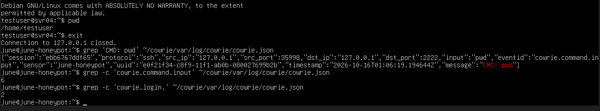
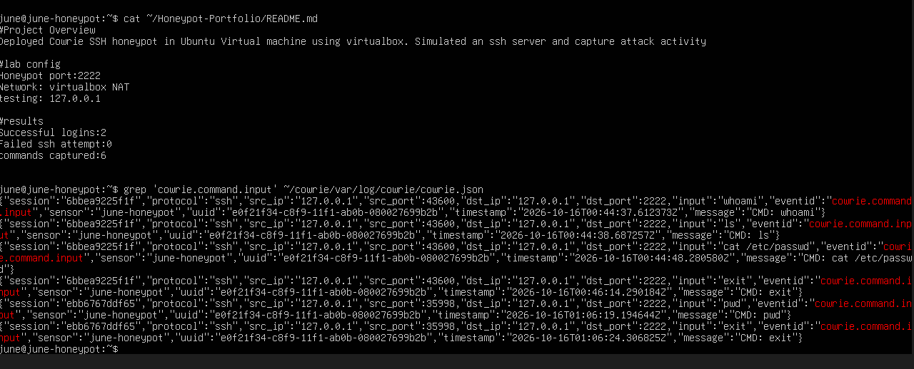
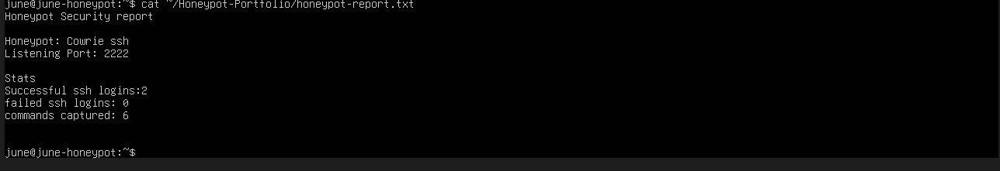

# Cowrie SSH Honeypot Lab

## Overview

I built this project to learn how honeypots work and how security analysts can use them to observe suspicious activity.

Using an Ubuntu virtual machine, I deployed Cowrie which is a SSH honeypot that simulates a Linux SSH environment and records activity from connecting users.

I then simulated ssh logins, executed commands inside the honeypot, and analyzed the resulting JSON logs.

## Lab Environment

| Component | Configuration |
|---|---|
| Operating System | Ubuntu Linux |
| Virtualization | Oracle VirtualBox |
| Honeypot | Cowrie SSH Honeypot |
| Listening Port | TCP 2222 |
| Network | VirtualBox NAT |
| Test Connection | 127.0.0.1 (localhost) |


## 1. Deploying the Honeypot

I created an Ubuntu virtual machine using VirtualBox and configured Cowrie to simulate an SSH service.

I picked Cowrie as it provides a simulated environment where commands and login attempts can be recorded without giving users access to a real operating system shell.

For this lab, the honeypot listened on port 2222, and I used localhost to perform controlled testing.

The purpose was to verify that the honeypot could capture SSH activity and produce logs suitable for security analysis.

## 2. Simulating SSH Activity

After starting Cowrie, I connected to the honeypot using an SSH client.

Then I simulated someone's reconnaissance my system

```bash
whoami
ls
cat /etc/passwd
exit
pwd
exit
```

## 3. Capturing and Analyzing Logs

Cowrie automatically recorded the SSH sessions and commands in its JSON log file.

I inspected the logs using Linux commands 

### SSH Activity and Log Verification



### Captured Commands

The JSON logs contained details such as session identifiers, timestamps, source addresses, destination ports, and executed commands.



## 4. Security Analysis Report

After reviewing the collected events, I created a simple security report summarizing the activity observed during testing.

### Results

| Metric | Result |
|---|---:|
| Successful SSH logins | 2 |
| Failed SSH logins | 0 |
| Commands captured | 6 |
| Listening port | 2222 |
| Test source | 127.0.0.1 |



The results confirmed that Cowrie successfully recorded the simulated SSH sessions and command activity.

I successfully deployed Cowrie, generated simulated SSH activity, captured the resulting logs, and documented the findings.

The project provided practical experience with Linux, SSH, security logging, and basic incident analysis.

A possible future improvement would be to integrate the honeypot logs with a SIEM platform to automate alert generation and investigate suspicious activity across multiple sources.
